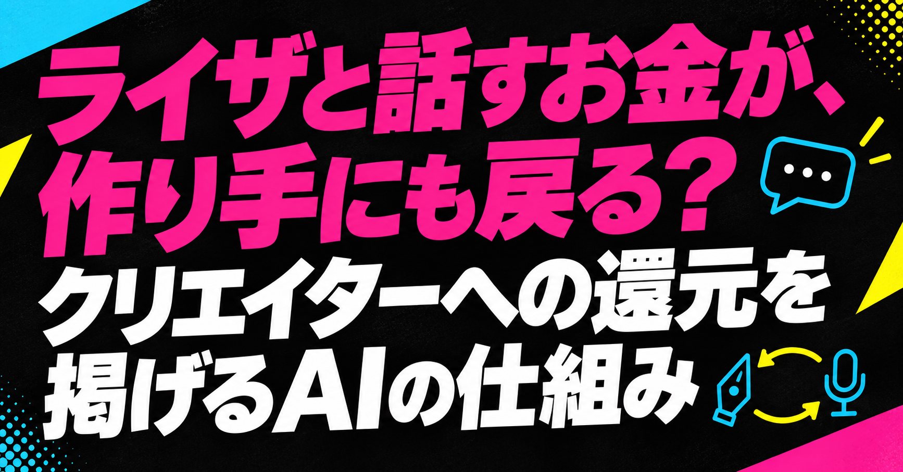

# ライザと話すお金が、作り手にも戻る？ クリエイターへの還元を掲げるAIの仕組み

※2026年10月7日更新：クリエイターへの収益還元を中心に、導入とまとめを更新しました。

こんばんは、ぐみです。

好きなキャラクターと話すために払ったお金が、その絵や声を作った人にも戻る。「RyzaChat:AI」が掲げる収益還元の方針には、そんな楽しみ方の広がりを感じます。

ライザと自由に話せるAIチャットでも、絵は人が作り、声は声優さんが収録した音声をもとにしています。AIを使うことと、作り手に仕事や対価が残ることは、両立できるのでしょうか。

今回は、人が用意する絵と声、原作を使う許諾、作り手への収益還元がどうつながるかを見ていきます。還元の方針は公表されていますが、実際の分配額や割合は分かりません。分かっていることと、まだ見えないことを分けながら、この仕組みの面白さを考えてみたいです。

## 『ライザのアトリエ』が公式AIチャットRPGに

コーエーテクモの人気シリーズ『ライザのアトリエ』から、AIチャットアプリ「RyzaChat:AI」が8月25日に配信開始されました。ライザと自由に会話しながら、フリーシナリオで"ひと夏の夢物語"が展開するアプリです。画像・動画生成AIは使わず、絵師さん・声優さんへの収益還元を設計に組み込んでいるのが特徴です。詳しくはこちら→[『ライザのアトリエ』チャットAIアプリ『RyzaChat:AI』いきなり配信 - AUTOMATON](https://automaton-media.com/articles/newsjp/20260825-462426/)

会話がその場で生まれるからといって、キャラクターの絵や声までAIだけで用意するわけではないんですよね。その素材を作った人にも売上を戻す方針が、今回気になったところです。

ライザの表情やしぐさには、平面のイラストを動かすLive2Dが使われ、AIの返答内容に連動します。素材はイラストレーターのトリダモノさんが監修し、すべて人の手で制作したもの。画像生成AI・動画生成AIは一切使っていないと明記されています。

声は、声優ののぐちゆりさんが収録した音声を素材に、SpiralAI独自の音声合成技術で再現しているとのことです。

売上は、使ったイラスト・音声・原作素材に応じて、イラストレーター・声優・原作の権利者へ還元すると説明されています。[SpiralAIの公式発表](https://prtimes.jp/main/html/rd/p/000000092.000120221.html)

つまり、ライザと話すお金を、絵や声の作り手にも戻す仕組みを掲げているわけです。実際の分配率や還元額までは分からないので、十分な対価が届いているとは言えません。それでも、人が素材を作り、AIが会話を生み、その売上を作り手へ戻す。この組み合わせは、AIで作り手を省くだけではない事業の形を見せてくれます。

## 会話の売上を、絵や声の作り手へ戻すには

ここからは、還元を続ける事業として考えてみます。素材を使う許諾があること、料金を払って楽しめること、作り手へ対価が戻ること。この三つはつながっていますが、どれか一つだけで、ほかも成立するとは言えません。

会話にかかる費用や許諾と照らし合わせて、その違いを見ていきます。

## ライザの絵・声・収益還元をつなぐ仕組み

### ライセンスを受けて開発するSpiralAI

RyzaChat:AIを開発しているのは、AIキャラクターとの対話サービスを手がける「SpiralAI株式会社」です。コーエーテクモゲームスからライセンスを受けて提供しています。

既存のゲーム作品やキャラクター、いわゆるIPを使う許諾を得ている点は、誰の素材か分からないまま似た絵や声を使うサービスとの違いです。ただ、ライセンスを受けていることだけでは、個々の作り手にどれだけ対価が届くかは分かりません。使う許可と、使った後にお金を戻す条件は、分けて読む必要があります。

### 収益還元は本当に機能するか

RyzaChat:AIは月額980円(年間プランなら実質500円)のサブスクが基本です。会話に使う「トークン」を追加購入する仕組みもあります。

売上をイラストレーターや声優、原作の権利者へ還元する方針には意味があります。ただ、課金の仕組みがあることと、十分に還元できることは別です。運営費をまかないながら作り手にもお金が戻るなら、ほかの作品の権利者がAIチャット化を考えるときの参考になりそうです。

ここで分けたいのは、利用者が払う総額、サービスを続ける費用、作り手へ戻る対価です。会話量が増えたとき、楽しむ時間だけでなく生成の費用も増えるなら、売上の増加だけを見ても還元が増えたとは言えません。追加のトークン購入が利用者にとって納得できるかと、運営費をまかなったうえで還元を続けられるかは、両方見たいところです。

私には、還元方針を掲げることと、それを長く続けることが別の仕事に見えます。前者は誰と一緒に作る事業かを示し、後者はファンが楽しむ時間を、作り手の次の仕事へつなげられるかという話です。分配率が分からない今は成功と判定せず、この二つを分けて追いたいです。

### イラストと声を、誰の許可で使うか

AIキャラクターを考えるうえでは、イラストと声の扱いが気になります。声優の津田健次郎さんは2025年11月、自分の声に酷似したAI音声動画が180本以上出回ったとして、動画の削除を求めてTikTok運営会社を提訴しました。

その点、RyzaChat:AIは、イラストを誰が制作・監修したか、音声を誰が収録したかを説明しています。売上の還元先も明記しています。すべての懸念がなくなるわけではありませんが、誰の素材をどう使っているかをたどれるのは、大事なところだと思います。

利用者にとっては、料金の分かりやすさも気になるところです。3日間の無料体験のあとは自動課金に切り替わり、会話量によってはトークンの追加購入も必要になります。月額料金でどこまで話せるのか。好きなキャラクターと過ごす時間だからこそ、そこは始める前に分かるといいですよね。

## 今夜はこのへんで

還元先が明記されていることは、誰と一緒に作るサービスかを知る手がかりになります。その関係を続けるには、ファンが払う料金と会話にかかる費用を考え、素材を使う許諾も守る必要があります。

AIが会話を作る一方で、人が作った絵や収録した声を使い、その売上を戻す。私には、素材の制作だけでなく、サービスが遊ばれる間も作り手へ対価を戻そうとする取り組みに見えます。実際の還元額は分かりませんが、好きなキャラクターと過ごす時間が、次の創作も支える仕組みになるならうれしいです。

## 参考リンク

- [『ライザのアトリエ』チャットAIアプリ『RyzaChat:AI』いきなり配信。予想を超える人気で延期後のマッハ対応 - AUTOMATON](https://automaton-media.com/articles/newsjp/20260825-462426/)

- [『ライザのアトリエ』チャットAIアプリ「RyzaChat:AI」発表。画像・動画生成AIは使用せず、収益は絵師や声優に還元 - AUTOMATON](https://automaton-media.com/articles/newsjp/ryazai-20260804-458244/)

- [SpiralAI株式会社 | Innovation LABパートナー紹介 - NTTPC](https://www.nttpc.co.jp/innovationlab/partners/spiral_ai.html)

- [SpiralAI、コーエーテクモゲームスよりライセンスを受けた『RyzaChat:AI』を8月4日に事前登録開始 - PR TIMES](https://prtimes.jp/main/html/rd/p/000000092.000120221.html)

- [【ライザチャット】値段（価格）は？課金しないとできない？ - ライザチャット攻略Wiki | Gamerch](https://gamerch.com/ryzachat/1006881)

- [津田健次郎さんがAI声模倣で提訴、争点は「類似性」と権利侵害 - Audiostart News](https://audiostart.info/2026/05/25/ai-voice-rights-lawsuit/)
