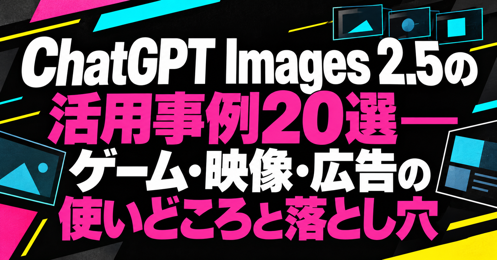

# ChatGPT Images 2.5の活用事例20選——ゲーム・映像・広告の使いどころと落とし穴

こんばんは、ぐみです。

きれいなAI画像ができても、そのまま作品に使えるとは限りません。ゲームで動かすなら切り出しや位置合わせが要りますし、編集を重ねるなら衣装や背景を保ちたい。商品広告なら、実物を正しく伝える必要もあります。

ChatGPT Images 2.5が出て、Xのタイムラインには試作がどっと流れてきました。今回は、見た目のよさから一歩進んで、次の作業へ渡すときにどこでつまずくかを見ていきます。

歩行アニメを作る人。静止画をつないで、コマ撮りのようなストップモーションにする人。 
VTuberの表情のバリエーション、商品広告、3D制作ソフトBlenderへ渡す資料までありました。 
「お、これ、次の作業にも使えそう。やるじゃん」と、素直に思いました。

取り上げるのは、2026年9月8日のOpenAI発表と、その直後に公開された20件の試作報告です。 
うまくいった例だけでなく、透過処理に手直しが要った例や、連続編集で指示が保たれなくなった例もあります。投稿者それぞれの試行から、自分の作品で使うなら何を確かめたいかを考えます。商用導入や一般的な性能を示す結果とは分けて読んでいきます。

## OpenAIが発表したImages 2.5の特徴

今回の発表では、参照画像をもとに編集を続けやすくなった点が気になります。

OpenAIは、参照画像の人物や物を保ちやすくなり、光や質感も自然になったと説明しています。 
指定した箇所だけを直し、複数回の編集でも前の変更を保ちやすくしたとのことです。 
生成時間も、Images 2.0と比べて最大50％短くなったとしています。

ChatGPT側には、スケッチを参照画像にするSketch、ポスターや商品写真などのテンプレート、画像にコメントを置いて修正箇所を伝える機能が加わりました。 
外部ソフトから利用するAPIでは、速度を重視したFlareと、細かな編集を重視したSunburstの2モデルが案内されています。

[OpenAIの発表](https://openai.com/index/introducing-chatgpt-images-2-5/) ｜[Flareのモデル仕様](https://developers.openai.com/api/docs/models/gpt-image-2.5-flare) ｜[Sunburstのモデル仕様](https://developers.openai.com/api/docs/models/gpt-image-2.5-sunburst)

## 一枚絵の先で、制作工程が動き出している

まずは、ゲーム、映像、広告・配信画面の試作を見てみます。

### ゲーム素材は、歩かせて初めて困る

852話(hakoniwa)さんは、戦闘中の動きをコマごとに一枚へ並べた「スプライトシート」を作ったと報告しています。 
ただし背景を透明にする透過処理は一度で決まらず、別チャットで分割と位置合わせまで指示したそうです。

<!-- note:embed -->
https://x.com/8co28/status/2097423580229521849
<!-- /note:embed -->

PURESOさんも、歩行と格闘のモーションを試しています。 
両足で歩くこと、衣装の特徴、複数の動きを、前世代との違いとして挙げています。

<!-- note:embed -->
https://x.com/pureso_studio/status/2097520619193868590
<!-- /note:embed -->

ゲーム用の絵って、一枚できれいなら終わりじゃないんですよね。 
コマごとに切り出せるか、背景を抜けるか、つなぐと自然に動くか。そこまで見て、素材として使えるかを考えたくなります。

### 映像の前に、連番を作る人たち

Charlie Guoさんは、同じキャラクターを保つストップモーションを試しました。 
Ivanaさんは36枚の画像をつなぎ、動画モデルを使わずに短い映像を作ったと報告しています。

<!-- note:embed -->
https://x.com/charlierguo/status/2097399137142772071
<!-- /note:embed -->

<!-- note:embed -->
https://x.com/ivanainai/status/2097446105906553188
<!-- /note:embed -->

Gabriel Chuaさんは、カワウソ、人物、屋台の見た目を99コマ(フレーム)にわたって保ったとしています。 
それを小さなストップモーションに組んだそうです。

<!-- note:embed -->
https://x.com/gabrielchua/status/2097512638704197681
<!-- /note:embed -->

必要な静止画を揃えて、映像として組み立てる。画像生成が、次の編集作業へじわっとつながっている気がします。

### 広告や配信画面では、残すものの方が大事

ぽんずさんは、元デザインの構図と世界観を保ちつつ、視点と文字を変える編集を試しました。

<!-- note:embed -->
https://x.com/ponzponz15/status/2097513870969688188
<!-- /note:embed -->

新清士さんは、ラーメンを宣伝する店頭の掲示物(POP)を作り、文字と写真の雰囲気に触れています。

<!-- note:embed -->
https://x.com/kiyoshi_shin/status/2097558667059155070
<!-- /note:embed -->

さきすたさんは、人物がライブ配信をしている画面風の画像を作りました。

<!-- note:embed -->
https://x.com/sakisuta_/status/2097558697174294896
<!-- /note:embed -->

広告や配信画面まで使い道が広がると、見栄えに加えて、何を残し、何を変えてよいかが気になります。商品を見せる画像なら、その商品として正しいかも確かめたいです。

## 使える素材かは、次の作業へ渡して分かる

20件の試作報告から、特に気になった落とし穴は、この三つです。

- **一枚ではよくても、切り出して動かすと使いにくい**：透過処理やコマの位置合わせまで含めて、ゲーム素材として見たいです。

- **直したいところ以外まで変わる**：人物・衣装・背景など、保ちたいものを決めて、編集前後を比べる必要があります。

- **きれいでも、実物を正しく伝えていない**：広告なら商品写真・文字・価格を元データと照らす工程が残ります。

そのAI画像を作品で使えるかは、一枚の見栄えだけでは決まりません。次に動かすのか、繰り返し編集するのか、商品を伝えるのか。使う場面に合わせて見る必要があります。これは、どの画像でも同じ問題が起きるという話ではなく、成功例とつまずいた例を読むための手がかりです。

ここからは、ゲーム素材、連続編集、3Dの参考資料、商品広告を比べます。3Dを作り直すための参考画像なら許せる違いでも、商品を見せる広告では困るかもしれません。どこまで手直しを前提にでき、何を変えてはいけないのか。成功例とつまずいた例から、その違いを掘ります。

## 試作を次の工程へ渡すとき、先に確認すること

投稿を追うと、下書きや構図案を作るところから、ゲームや3Dへ素材を渡すところまで、試す範囲が広がっています。次に使うソフトが変わると、画像に求めるものも変わってきます。

### ゲーム用素材は、動きと分解で価値が決まる

スプライトシート、歩きや格闘の動き、表情のバリエーションを試した投稿には共通点があります。 
キャラクターの一枚絵を作ったあと、パーツに分け、動かし、表情の違いを増やす前提です。

しとちゃ！さんは表情のバリエーションを作り、顔の動きを読み取るアプリiFacialMocapと組み合わせて、表情を動かす仕組みを試しました。

<!-- note:embed -->
https://x.com/nemumusitocha/status/2097430181095125251
<!-- /note:embed -->

Simonasさんは、画像から3Dモデルを作るTripo3Dを使い、Images 2.5の画像をGLB形式の3Dデータに変換しました。 
それを、ブラウザで3Dを表示できるThree.jsへ渡したと報告しています。

<!-- note:embed -->
https://x.com/SimonasLTU1/status/2097561634076016774
<!-- /note:embed -->

Higgsfield AIは、Images 2.5で生成した画像を使い、ゲーム制作ソフトUnityで対戦ゲームを作ったと紹介しています。 
サービス提供側の紹介なので、制作時間や性能の評価は別に必要です。画像をゲームの実装までつないだ例として見ると、使い道を想像しやすくなります。

<!-- note:embed -->
https://x.com/higgsfield_ai/status/2097470354897740109
<!-- /note:embed -->

一枚絵、表情のバリエーション、3Dにするための画像では、使える素材の条件が違います。画風を眺めるだけでなく、次の工程へ持っていったときにどれだけ手直しが必要かも見たくなります。

ここは、成功例をそのまま別の用途へ移さないためにも分けたいです。表情の違いを見せる資料として使えることと、動きをつなぐコマとして使えることは別です。3Dの見た目を共有する画像なら多少の手直しを前提にできても、ゲームでそのまま表示する素材なら、切り出しや位置合わせが採用の条件になります。

### 連続編集では、変えてはいけないものを先に決める

Chetasluaさんは、立方体を連続編集して位置・大きさ・背景の変化を比較しました。 
同じ指示を出しても、毎回まったく同じ結果になるわけではない、と投稿内で明記しています。

<!-- note:embed -->
https://x.com/chetaslua/status/2097400738096062755
<!-- /note:embed -->

AGIラボさんは、ロボットが星を拾い、持ち上げ、元に戻す9回の連続編集を比較しました。

<!-- note:embed -->
https://x.com/ctgptlb/status/2097479691368337900
<!-- /note:embed -->

关木さんは、人物、服、街、光を保ちながら、12場面の画像を試しています。 
一方でZenMuxの販売案内も含む投稿です。広告文と試行結果は分けて読みたいところです。

<!-- note:embed -->
https://x.com/ZeroZ_JQ/status/2097560885606973599
<!-- /note:embed -->

-Zho-さんは、10回の連続生成後にタスクを忘れると報告しました。

<!-- note:embed -->
https://x.com/ZHO_ZHO_ZHO/status/2097573152675316038
<!-- /note:embed -->

人物は同じでも、衣装や背景が変わっていたら困る仕事もあります。今回どこを保ちたいのかは、編集を始める前に決めておきたいです。

「この服は変えない」のような条件があれば、結果を並べて確かめられます。成功した投稿と崩れた投稿を比べるときも、何を固定しようとしていたかが手がかりになります。

### 映像や3Dの見た目を、静止画で共有する

静止画を順番につないでストップモーションにする投稿は、画像モデルの役割を少し変えています。 
動画生成モデルを使わなくても、必要な静止画を揃え、別の編集工程で動かす方法です。

Will Oldgramさんは、生成したキューブ都市を、3D制作ソフトBlenderで作り直すための見た目の参考に使ったと報告しています。

<!-- note:embed -->
https://x.com/old_pgmrs_will/status/2097506064078147861
<!-- /note:embed -->

Karanさんは、戦闘機のスケッチを写実的な画像へ変え、AIモデルのAstraを使ってBlender用の3Dモデルにしたとしています。

<!-- note:embed -->
https://x.com/karankendre/status/2097430655336620509
<!-- /note:embed -->

こうした例では、生成画像を、構図や質感、光、立体化したときの見た目を共有する資料にしています。 
映像や3Dの担当者が直せる余地を残して渡せるなら、企画初期の会話はかなり速くなりそうです。

## 広告では、きれいに見えることと正確なことを分ける

同じものを保ちながら編集したい、という話は広告にもつながります。ただ、商品を扱うなら、写真に似ているかだけでは足りません。ロゴや価格、使う素材の許可まで確かめる必要があります。

### 商品写真を使うなら、元データの扱いを決める

Mikoさんは、参照画像を使ってAIらしさを抑えた人物写真を作る手順を紹介しています。 
商品や人物を含む広告制作に応用できそうですが、商品や手順の販売案内も含む投稿です。 
素材ごとに分けて指示した一例として読むのがよさそうです。同じ結果が出るかは、使う素材や条件にもよります。

<!-- note:embed -->
https://x.com/Mho_23/status/2097483045221917131
<!-- /note:embed -->

EPさんは、ユーザー投稿風の広告動画の冒頭用に、Images 2.5 Sunburstを使ったとしています。 
こちらもHiggsfieldというサービス内での利用を紹介する投稿です。

<!-- note:embed -->
https://x.com/eptwts/status/2097477534057128376
<!-- /note:embed -->

広告で本当に必要なのは、モデルが商品を描けることだけではありません。 
商品写真を使う許可があるか。ロゴや価格、画面内の文言は正しいか。人物素材の同意は取れているか。 
最終稿では、ここを一つずつ確かめる必要があります。 
生成の手間が減っても、校正の責任は残ります。

### 文字と図解は、読めても確認が要る

Minsang Daniel Kimさんは、文字が重ならない教育用の図を一発で作れたと投稿しています。

<!-- note:embed -->
https://x.com/msdkim0424/status/2097558747124277308
<!-- /note:embed -->

文字を画像内で扱いやすくなれば、広告POPや配信画面、教材、ゲーム内の画面の試作は速くなります。 
でも、誤字、価格表記、仕様、読み順は別の話です。 
人が元データと照らす工程を残せるかが、実務に入る最低条件だと思います。

## 飲食店の販促では、写真と実物の差が問題になる

2026年8月には、生成AIで作られたとみられる飲食店のメニューや店頭ポスターが、Xで「食欲が削られる」「実物と違うのでは」と話題になりました。

食べ物の描写に違和感を覚える人もいるため、画像は[報道記事へのリンク](https://www.itmedia.co.jp/news/article/2608/18/2000000580/)だけにしておきます。

私が気になったのは、見た目の違和感の先に「この料理が本当に出てくるのか」という疑問があることです。文字や価格が正しいかも含めて、メニューは注文するための情報なんですよね。

どんな編集工程でその画像ができたかまでは、この反応だけでは分かりません。ただ、実物と違う料理を見せてしまえば、注文する人との約束がぼやけてしまいます。

Images 2.5の部分編集や、ポスターの文字・構図を差し替える試作は、この用途でも気になります。元写真を保って必要なところだけ直せれば、販促物を作る助けになりそうです。ただ、それができるかは実際の商品写真で確かめる必要があります。

飲食店でAI画像が使われるとしても、料理そのものは実写で示し、AIは背景や構図案、装飾などに限定する方が誤解を減らせそうです。 
文字、価格、商品写真を元データと照らす工程は、やっぱり残しておきたいです。 
「AIで安く作れた」より、実物を楽しみに来た人をがっかりさせない。 
店頭販促では、そっちが先だと思います。

## 今夜のまとめ

ゲーム素材では動かせること、3Dの参考では見た目を共有できること、広告では実物を正しく伝えること。同じ画像生成でも、次にする仕事が違えば、採用したい結果も変わります。

3Dの参考にする画像は、その後に人が作り直す余地があります。一方、ゲームで動かすコマや商品を見せる広告は、画像の違いがそのまま動きや商品情報に影響します。「よくできた一枚」を探すより、自分の工程で許せる違いを決める。その見方なら、成功した試作も、手直しが要った試作も、採用を考える材料になります。

## 参考リンク

- [OpenAI: Introducing ChatGPT Images 2.5](https://openai.com/index/introducing-chatgpt-images-2-5/)

- [OpenAI: GPT-Image-2.5 Sunburst](https://developers.openai.com/api/docs/models/gpt-image-2.5-sunburst)

- [OpenAI: ChatGPT Images 2.5 Safety Evaluations](https://deploymentsafety.openai.com/chatgpt-images-2-5/safety-evaluations)

- [Axiosの試用記事](https://www.axios.com/2026/09/08/exclusive-hands-on-with-chatgpts-new-image-editor)

- [TechRadarの検証記事](https://www.techradar.com/ai-platforms-assistants/chatgpt/chatgpt-images-2-5-is-out-ive-been-testing-it-for-24-hours-and-these-are-the-3-new-features-youll-actually-use)

- [ITmedia NEWS: AIで作られた飲食店メニュー・ポスターへの反応](https://www.itmedia.co.jp/news/article/2608/18/2000000580/)

- [ASCII.jp: 飲食店のAI販促物が話題になった背景](https://ascii.jp/elem/000/004/427/4427098/)

※2026年9月16日更新：専門用語の説明と見出しを整理し、飲食店の販促物について、投稿への反応と私の見立てを分けました。紹介する20件の投稿は変更していません。

※2026年10月7日更新：20件の公開試作報告から、作品利用で気になる落とし穴を導入とまとめに整理しました。
