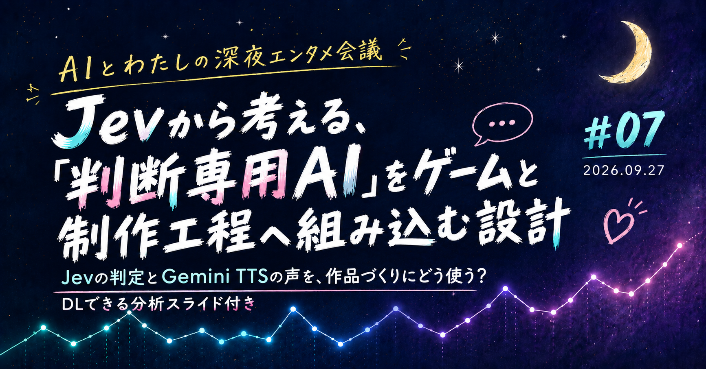
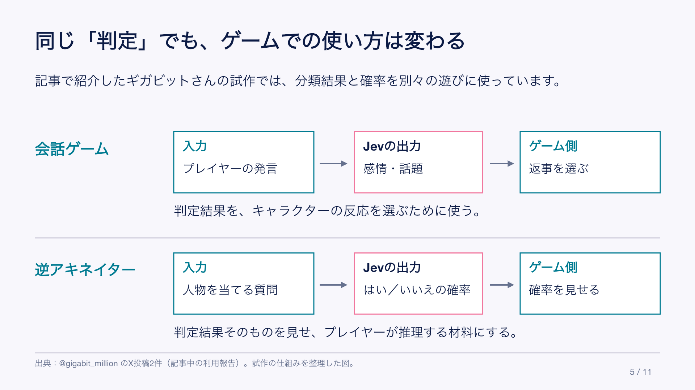
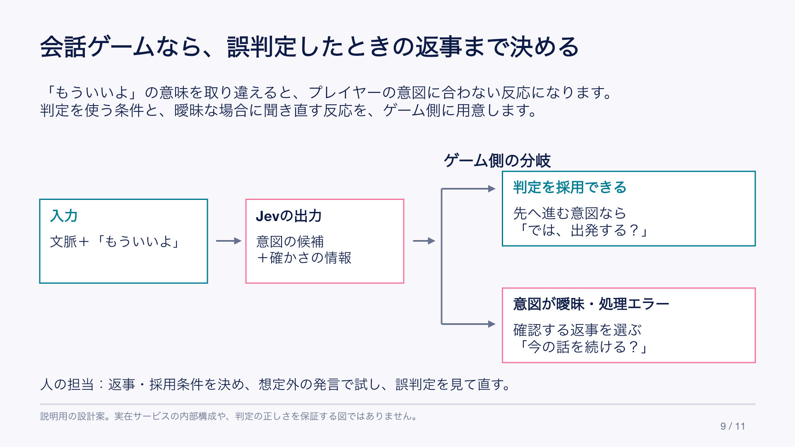
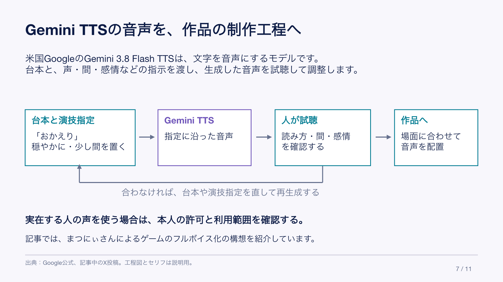
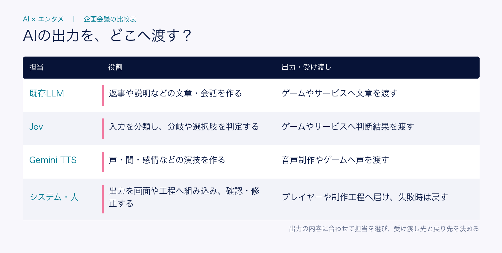

# Jevから考える、「判断専用AI」をゲームと制作工程へ組み込む設計｜AIとわたしの深夜エンタメ会議 #07

こんばんは、ぐみです。

## まず、AIが作品のどこで働くのか

「AIエンタメ」と聞くと、画像や文章を作る場面を思い浮かべるかもしれません。けれど、今回取り上げるのは、もう少し裏側の仕事です。

たとえば、ゲームの登場人物が次の行動を選ぶ。試合の状況に合わせて解説コメントを返す。キャラクターの声に、間や感情をつける。AIが作品の途中に入り、ゲームの分岐や音声制作へ結果を渡す使い方です。

今回、タイトルに選んだJevは、その違いが分かりやすい例です。Jevは長い文章を返すことより、「どの選択肢を選ぶか」「何点と評価するか」のように、決まった形で判断を返すモデルとして紹介されています。ゲームで使うなら、キャラクターが次に何をするかを決める裏側に置けます。

つまり、今回の問いは「AIは何を作れるか」だけではありません。「AIの出力を、誰が受け取り、ゲームの分岐・画面表示・音声制作のどこで使うのか」です。この入口から、今回取り上げるニュースと、そこから考えた運用設計を見ていきます。

ゲーム、音声、スポーツ配信、キャラクター、公演。並べてみると、AIが作品の素材を作るだけではなく、作品の中で判断したり、演じたり、解説したり、運用を支えたりする場面が見えてきました。

第1部では、AI×エンタメの最新情報を6件紹介します。第2部では、JevとGemini TTSを取り上げ、「判断専用AI」を入口に、AIの出力をゲームの分岐や音声制作へどう組み込むかを考えます。後半には、企画会議で使える分析スライドも付けています。

## 第1部：AI分野最新情報

### 【米国】Jev：AIが文章ではなく、ゲームやサービスの判断を返す

米国のTypeSafe AIが開発するJevは、「どれを選ぶか」「何点か」といった判断を、あらかじめ決めた項目で返すモデルです。文章で渡した状況をもとに、選択肢やスコア、確率などを返します。ゲーム内の選択やNPC（ゲーム内の登場人物）の反応など、プログラムで結果を受け取りたい場面に使う設計です。

[TypeSafe AI公式ドキュメント](https://docs.typesafe.ai/introduction) ｜ [モデル仕様](https://docs.typesafe.ai/models)

AIを「文章を書く人」として見ると、Jevは少し違って見えます。作品の中で次の分岐を選ぶ、評価を返す、といった裏側の判断を任せるAIです。返ってくる項目が決まっているぶん、どこで人間が確認するかも決めやすそうです。

### 【米国】Gemini 3.8 Flash TTS：声とセリフの間を言葉で設計する

米国のGoogleは、キャラクターの声、セリフの間、感情、方言などを言葉で指定できる音声生成基盤を発表しました。TTSは「Text to Speech」、つまり文章を音声に変える技術のことです。声を出すだけでなく、演技の条件を指定する方向へ、音声制作の入口が広がっています。

[Google公式](https://blog.google/innovation-and-ai/models-and-research/gemini-models/gemini-3-8-text-to-speech/)

キャラクターに声を付ける作業では、声質だけでなく、どこで息を吸うか、どの言葉を強くするかが印象を作ります。自然言語でそこを試せるなら、音声制作の試行回数は増やしやすくなりそうです。ただし、声の再現や生成を使うときは、提供条件と同意の範囲を先に確認したいところです。

### Rakuten TV「AI解説者」：試合の状況に合わせてコメントする

Rakuten TVは、試合状況と選手データに応じた解説コメントをリアルタイムに生成する「AI解説者」のβ版を提供開始しました。β版は試験提供中の機能という意味で、今回は対象サービスの利用者が使えます。解説は音声ではなくテキストで表示され、試合を見ながら選手の成績などを確認できます。

[楽天公式](https://corp.rakuten.co.jp/news/press/2026/0918_01.html)

実況や解説は、正しい情報だけでなく、出すタイミングも体験の一部です。AIがコメントを作れるかだけでなく、どの情報を表示し、間違ったときにどう止めるかまで含めて、視聴体験として見たいニュースです。

### SophieChat:AI：ライザの次に、ソフィーと話せる公式ライセンス型RPG

SpiralAIは、東京ゲームショウ2026で『ソフィーのアトリエ2』の世界を舞台にしたAIチャットRPG「SophieChat:AI」と事前登録を発表しました。会話で展開が変わり、旅・調合・戦闘を楽しめる設計です。公式サイトでは、許可を得た音声の利用、原作キャラクターデザイナーが監修した手描きの素材、収益の一部を協力クリエイターへ還元する仕組みが説明されています。

[SophieChat:AI公式](https://sophiechat-ai.go-spiral.ai/) ｜ [SpiralAI発表](https://prtimes.jp/main/html/rd/p/000000099.000120221.html)

ライザに続いてソフィーが出てきたことで、原作らしさを守りながら、権利者やクリエイターと協力してAIキャラクターを作る方法が気になります。開発中で、価格や配信日はまだ分かりません。公式ライセンスや音声の許諾、収益還元の仕組みが先に示されている点に注目しました。

### 【韓国】Nexon「ファレイドリア」：端末内でキャラクターとの会話を試す

韓国のNexon Gamesは、声でキャラクターを呼んだり、会話の選択肢を選んだりする機能を試作しています。開発責任者のキム・ヨンハ氏はGamemecaのインタビューで、端末内で処理する自社開発の「オンデバイスAI」を使い、この音声機能は別のサーバーなしで動くと説明しました。現段階は呼びかけや簡単なやり取りのデモで、今後の拡張はTGSでの反応を見て判断するとのことです。

[Nexon公式TGSサイト](https://cmn-jp.nexon.com/event/tgs2026/fareidolia) ｜ [開発責任者インタビュー（Gamemeca）](https://www.gamemeca.com/en/view.php?gid=1780461)

会話AIは、賢さだけでなく、通信、返事が届くまでの遅れ、発熱、ログ（利用履歴）の扱いと一緒に考える必要があります。端末内でどこまで成立させるのかは、キャラクター体験の自由度と、運用上の制約をどう釣り合わせるかという問いになりそうです。

### 【英国】Unit1 Studio：本人を再現したデジタル公演を別会場へ移す

英国のUnit1 Studioが扱うアバター公演は、実在のアーティストを再現した高精細なデジタル映像やCGを、ステージ上の演出として見せる公演です。同社は、この公演を専用会場に固定せず、別会場へ移設する取り組みを示しました。Pollstarの記事では、KT Tunstallの公演をロンドンの別会場へ移したことと、商用展開に向けた2,000万ドルの投資が報じられています。

これはAI機能そのものというより、AI・CGを含むデジタル公演を、どう運び、続けていくかを見る事例です。

[Pollstar](https://news.pollstar.com/2026/09/22/unit1-studio-secures-20m-investment-towards-commercial-adoption-of-avatar-concerts-and-taking-them-on-the-road/)

この形式の公演の価値は、映像がきれいかどうかだけで決まりません。会場を変えても制作・演出・音響を保てるか。投資額だけで市場の成立を証明できるわけではありませんが、「移せる」という運用単位で考えられるようになった点には、進展を感じます。

ここまでのニュースは、AIが作品の一部を生成する話だけではありません。判断を返し、声を演じ、試合を解説し、キャラクターの会話を支え、公演の運用を広げる話です。ここからはJevとGemini TTSを軸に、「AIが何を出すか」より「ゲームの分岐や制作工程のどこで使うか」を見ていきます。

会社の企画会議やレビューで使える分析スライド（PDF・PPTX）も付けています。メンバーシップでは過去記事も含めて読み放題、個別購入でもお読みいただけます。

<!-- note:paid-start -->

## 第2部：「判断専用AI」から考える、AIの出力をゲームと制作工程へ組み込む設計

第2部では、Jevを起点に、AIの出力をゲームの分岐や音声制作へ組み込む設計を見ていきます。

前号では、キャラクターと話した後に何を遊べるかを比べました。今回は、Jevの分類や分岐を中心に、Gemini TTSの音声制作を比較します。AIの種類は違っても、出力をゲームや制作工程のどこで使うのか、誰が確認し、失敗したときにどう戻すのかを考えます。

### Jevは何を入力し、どんな判断を返すのか

X上でJevを説明する投稿には、「判断専用AI」という呼び方が出てきます。この言葉を使うと、Jevの役割が見えやすくなります。

ここでいう判断は、作品の良し悪しを最終決定することではありません。入力を分類したり、いくつかの選択肢からどれが近いかを返したりして、ゲームやサービスの処理へ渡す役割です。

入力するのは、プレイヤーの発言や直前の会話などを文章にした情報です。公式仕様にあるJev 1.13はテキスト入力に対応し、画像・音声・動画を直接読み取るモデルではありません。声で操作するゲームなら、音声を文字に変える処理を別に用意します。

### Jevが返す判定を具体例で見る

Jevの特徴は、長い文章を自由に生成するより、決まった形式で判断を返すことです。入力した内容に対して、次のような判定結果を返します。

- あらかじめ決めた選択肢のどれに近いか
- 「はい／いいえ」や感情・話題などの分類
- 選択肢ごとの確率や評価

たとえば、会話ゲームでプレイヤーが「もういいよ」と言ったとします。準備ができたのか、話を打ち切りたいのか。この一言だけでは決められません。設計例としては、直前の会話も入力し、「先へ進みたい」「話を終えたい」といった候補からJevに判定させ、その結果を見てゲーム側が返事を選ぶ流れが考えられます。

ChatGPTなどの基盤にあるLLM（大規模言語モデル）でも、分類や決まった形式での回答はできます。「判断専用AI」は、判断ができる唯一のAIという意味ではありません。Jevは、選択肢やスコアをプログラムで扱うための仕組みとして提供されています。[公式ドキュメント](https://docs.typesafe.ai/introduction)にも、判断を小さな問いに分け、結果をコードで組み合わせる考え方が示されています。

つまり、Jevは「答えを文章で返すAI」というより、「ゲームやサービスが処理を選べる形に整えるAI」です。この違いを押さえてから、実際にどんな組み込み方が試されているかを見ていきます。

### Jevの判定をサービスの処理に使う

テツメモさんは、JevをCodexやClaude Codeから使い、サービスやアプリに組み込む方法を紹介しています。Jevを単体のチャット相手として見るよりも、既存の開発工程へ差し込む判断レイヤーとして捉える投稿です。

<!-- note:embed -->
https://x.com/tetumemo/status/2102881000846172441
<!-- /note:embed -->

一方で、國光宏尚さんは、JevはChatGPTやClaudeの代替ではないと書いています。こちらは、話題のAIを何でもできる新しい道具として扱わず、文章生成と判断処理の役割を分けて考える視点です。

<!-- note:embed -->
https://x.com/hkunimitsu/status/2102906502566772748
<!-- /note:embed -->

Jevの判定は、別の処理にも渡せます。分類とは、長い文章を生成することより、入力を決めた選択肢へ振り分けることです。

木村さんは、Jevに「AはBか？」を判定させるサイトを作り、AとBの関係を高速に確かめられる形にしています。

<!-- note:embed -->
https://x.com/Bioinfo_Kimura/status/2100868868197712225
<!-- /note:embed -->

usutaku_channelさんの投稿では、メールを営業・請求・サポートのような窓口へ振り分ける使い方が紹介されています。これはエンタメそのものではありませんが、作品なら、プレイヤーの発言を「質問」「感想」「要望」に分け、その結果でキャラクターの返事やゲームの分岐を変えるイメージにつながります。Jevを、作品の文章を作るAIとは別の、ゲームの返事や画面分岐へ渡す部品として理解する入口です。

<!-- note:embed -->
https://x.com/usutaku_channel/status/2100829343954173965
<!-- /note:embed -->

### 分類結果をゲームの反応へ渡す

分類結果が、ゲーム側の返事や分岐に使われる例もあります。ギガビットさんは、入力した言葉から感情と話題を判定するチャットゲームを作っています。Jevは会話文を担当せず、ゲーム側が返事を選ぶための材料を返しています。

<!-- note:embed -->
https://x.com/gigabit_million/status/2101285853859545263
<!-- /note:embed -->

同じ投稿者は、Jevの「はい／いいえ」の確率を使った逆アキネイターも紹介しています。答えを一つ返すだけでなく、「いいえ99％」のような確率が表示されることで、プレイヤーがその判断を疑いながら推理する体験につながっています。

<!-- note:embed -->
https://x.com/gigabit_million/status/2101044610755875174
<!-- /note:embed -->

*会話ゲームでは判定を返事選びに使い、逆アキネイターでは確率そのものを推理の材料にします。*

### 意味を取り違えたときの返事も用意する

先ほどの「もういいよ」を、架空の会話ゲームの設計例としてもう少し考えてみます。準備ができたつもりで言ったのに、キャラクターが会話を打ち切ったら、プレイヤーは戸惑います。判定結果をそのまま使ってよい場面と、聞き直す場面を分けておきたいです。

直前に「出発の準備はできた？」と聞いていて、先へ進む意図だと判定できた場合は、ゲーム側が「では、出発する？」という返事を選ぶ。候補の確率が近く、意図を絞れない場合は、「今の話を続ける？」と確認し、続ける・終えるの選択肢を出す。処理エラーで結果が返らない場合にも、選択肢で遊びを続けられるようにします。

*図：判定に迷う場合は、ゲーム側で確認の返事を選びます。返事と採用条件を用意するのは人の担当です。*

どの程度の確かさなら採用するかは、実際のセリフを使って試す必要があります。確率が高くても、正しいとは限りません。特に日本語の精度は英語と同等ではないため、自分の作品の会話で確かめるよう[公式仕様](https://docs.typesafe.ai/models)でも案内されています。

### 制作途中の「選ぶ」作業にも使えるか

田中義弘さんは、Jev-Omniを映像の良否、素材選定、カット選択など、制作途中の「選ぶ」作業に使える可能性を考えています。

ただし、公式仕様で確認できるJevはテキスト入力です。映像をそのまま渡してカットを選べる機能としては扱えません。いまの仕様で考えるなら、各カットの説明やセリフを文章にし、選定条件と照らし合わせる使い方になります。映像の見栄えや演技の良さまで判定できるかは、別に確かめる必要があります。

<!-- note:embed -->
https://x.com/taziku_co/status/2102897168453599718
<!-- /note:embed -->

### Gemini TTSで、生成した声を作品づくりに使う

Jevのように判定を返すAIとは別に、Gemini 3.8 Flash TTSでは、生成した声を作品づくりに使えます。TTSは、文字を音声に変換する仕組みです。キャラクターの声、セリフの間、感情などを言葉で指定して演技を試せます。まつにぃさんは、ほぼプロンプトを指定せずにボイスを作り、「もっと凝れそう」と試行の余地を書いています。

<!-- note:embed -->
https://x.com/yugen_matuni/status/2103017150806118595
<!-- /note:embed -->

その後の投稿では、制作中のローグライクゲームのノベルパート全キャラクターに声を当て、ゲームをフルボイスにする構想まで進めています。音声生成が、単体のデモから作品づくりへ広がっています。

<!-- note:embed -->
https://x.com/yugen_matuni/status/2103079022259564943
<!-- /note:embed -->

一方、松丸彗吾さんは自分の声をクローンし、感情を強めた読み上げを試しています。投稿では、自分や周囲の人に許可を取って使う可能性にも触れています。音声の自然さだけでなく、「誰の声を、どの範囲で使ってよいのか」まで一緒に考える入口になります。

<!-- note:embed -->
https://x.com/k_matsumaru/status/2103000989779546232
<!-- /note:embed -->

*生成した声は人が試聴し、作品に合わなければ台本や演技指示を直して再生成します。*

### AIの出力をどこへ渡すか、企画会議で確認する

ここまでの例を、AIとシステム・人の担当に分けると次のようになります。四つを必ず順につなぐわけではなく、作りたい機能に合わせて選びます。

*4つの担当ごとに、作るものと出力の受け渡し先を整理しています。*

この表を企画会議で使うときは、次の順で確認します。

1. AIは何を入力として受け取るのか
2. どんな判定・生成を返すのか
3. その出力を、誰がどの画面・工程で受け取るのか
4. 間違ったとき、どこへ戻すのか

ここまで決めておくと、「AIを入れたい」という話を、実際の体験設計へ進められます。

AIエンタメを見るときも、「何を生成できるか」だけでなく、出力がどこで使われるかを見ていきたいです。Jevの判定はゲームの分岐に届くか。TTSの声は音声制作の工程で使えるか。

先に決めたいのは、AIに任せる範囲、人間が確認する場所、失敗時に戻る道です。この三つが、AIを作品の一部として続けて使うための土台になります。

## まとめ

AI×エンタメの変化は、生成物が増えたことだけではありません。AIの出力が、ゲームの分岐、画面表示、音声制作の工程に組み込まれています。

前号では、キャラクターと話した後に何を遊べるかを比べました。今回は、AIの判断や声をゲームと制作工程へ組み込むとき、どこまで設計しておく必要があるかを考えました。

これからAI×エンタメを見るときは、生成デモの派手さだけでなく、問いをひとつ置いてみたいです。そのAIの出力は、ゲームの分岐や画面表示、音声制作のどこを変え、失敗したときにどこへ戻れるのでしょうか。

この記事には、テーマ比較をまとめたPDFとPPTXを付けています。まず読むならPDF、会議や企画レビューに合わせて編集・再利用したいときはPPTXをご利用ください。

<!-- note:file -->
[PDF版](slides/20260924_ai-entertainment-night-07.pdf)
<!-- /note:file -->

<!-- note:file -->
[PPTX版（編集用）](slides/20260924_ai-entertainment-night-07.pptx)
<!-- /note:file -->

## 参考リンク

- [TypeSafe AI公式：Jevの概要](https://docs.typesafe.ai/introduction)
- [TypeSafe AI公式：モデル仕様](https://docs.typesafe.ai/models)
- [Google公式：Gemini 3.8 Flash TTS](https://blog.google/innovation-and-ai/models-and-research/gemini-models/gemini-3-8-text-to-speech/)
- [楽天公式：AI解説者](https://corp.rakuten.co.jp/news/press/2026/0918_01.html)
- [SophieChat:AI公式](https://sophiechat-ai.go-spiral.ai/)
- [SpiralAI発表：SophieChat:AI](https://prtimes.jp/main/html/rd/p/000000099.000120221.html)
- [Nexon公式TGSサイト：ファレイドリア](https://cmn-jp.nexon.com/event/tgs2026/fareidolia)
- [Gamemeca：Nexon Games開発責任者インタビュー](https://www.gamemeca.com/en/view.php?gid=1780461)
- [Pollstar：Unit1 Studio](https://news.pollstar.com/2026/09/22/unit1-studio-secures-20m-investment-towards-commercial-adoption-of-avatar-concerts-and-taking-them-on-the-road/)
