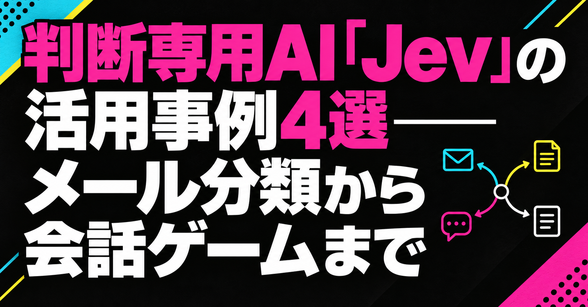

# 判断専用AI「Jev」の活用事例4選——メール分類から会話ゲームまで

こんばんは、ぐみです。

## セリフは作る側が用意して、選ぶ判断をAIに任せる

AIをゲームに入れると聞くと、キャラクターのセリフをその場で作らせる使い方を思い浮かべます。でも、セリフや分岐は作る側が用意し、どれを選ぶかだけAIに任せる使い方もあるんですよね。

たとえば、プレイヤーの発言から感情や話題を分類し、その結果に合う返事をゲーム側で選ぶ。自由に文章を書かせなくても、プレイヤーの言葉に応じて反応を変えられます。

米国のTypeSafe AIが開発するJevは、「どれを選ぶか」「何点か」といった判断を、あらかじめ決めた項目で返すモデルです。ゲームで使うなら、キャラクターが次に何をするかを決める裏側に置けます。

今回は、Jevの判定をゲームの返事や分岐へ渡す作り方を見ます。判定内容が期待と違う場合と、出力を受け取れない場合も分けて、ゲーム内部で何を決めておくかを考えます。

## AIの判定を、ゲームが扱える結果として組み込む

返事を選ぶ材料にするのか、確率そのものをプレイヤーへ見せるのか。同じ判定結果でも、ゲームでの使い方は変わります。まず、Jevが受け取れる情報と返す結果を押さえ、二つの遊び方を見ていきます。

### Jevは何を入力し、どんな判断を返すのか

X上でJevを説明する投稿には、「判断専用AI」という呼び方が出てきます。この言葉を使うと、Jevの役割が見えやすくなります。

ここでいう判断は、作品の良し悪しを最終決定することではありません。入力を分類したり、いくつかの選択肢からどれが近いかを返したりして、ゲームやサービスの処理へ渡す役割です。

入力するのは、プレイヤーの発言や直前の会話などを文章にした情報です。公式仕様にあるJev 1.13はテキスト入力に対応し、画像・音声・動画を直接読み取るモデルではありません。声で操作するゲームなら、音声を文字に変える処理を別に用意します。

### Jevが返す判定を具体例で見る

Jevの特徴は、長い文章を自由に生成するより、決まった形式で判断を返すことです。入力した内容に対して、次のような判定結果を返します。

- あらかじめ決めた選択肢のどれに近いか

- 「はい／いいえ」や感情・話題などの分類

- 選択肢ごとの確率や評価

たとえば、会話ゲームでプレイヤーが「もういいよ」と言ったとします。準備ができたのか、話を打ち切りたいのか。この一言だけでは決められません。設計例としては、直前の会話も入力し、「先へ進みたい」「話を終えたい」といった候補からJevに判定させ、その結果を見てゲーム側が返事を選ぶ流れが考えられます。

ChatGPTなどの基盤にあるLLM（大規模言語モデル）でも、分類や決まった形式での回答はできます。「判断専用AI」は、判断ができる唯一のAIという意味ではありません。Jevは、選択肢やスコアをプログラムで扱うための仕組みとして提供されています。[公式ドキュメント](https://docs.typesafe.ai/introduction)にも、判断を小さな問いに分け、結果をコードで組み合わせる考え方が示されています。

つまり、Jevは「答えを文章で返すAI」というより、「ゲームやサービスが処理を選べる形に整えるAI」です。この違いを押さえてから、実際にどんな組み込み方が試されているかを見ていきます。

### Jevの判定をサービスの処理に使う

テツメモさんは、JevをCodexやClaude Codeから使い、サービスやアプリに組み込む方法を紹介しています。Jevを単体のチャット相手として見るよりも、既存の開発工程へ差し込む判断レイヤーとして捉える投稿です。

<!-- note:embed -->
https://x.com/tetumemo/status/2102881000846172441
<!-- /note:embed -->

一方で、國光宏尚さんは、JevはChatGPTやClaudeの代替ではないと書いています。こちらは、話題のAIを何でもできる新しい道具として扱わず、文章生成と判断処理の役割を分けて考える視点です。

<!-- note:embed -->
https://x.com/hkunimitsu/status/2102906502566772748
<!-- /note:embed -->

Jevの判定は、別の処理にも渡せます。分類とは、長い文章を生成することより、入力を決めた選択肢へ振り分けることです。

木村さんは、Jevに「AはBか？」を判定させるサイトを作り、AとBの関係を高速に確かめられる形にしています。

<!-- note:embed -->
https://x.com/Bioinfo_Kimura/status/2100868868197712225
<!-- /note:embed -->

usutaku_channelさんの投稿では、メールを営業・請求・サポートのような窓口へ振り分ける使い方が紹介されています。これはエンタメそのものではありませんが、ゲームでの使い方も想像できます。プレイヤーの発言を「質問」「感想」「要望」に分け、その結果でキャラクターの返事やゲームの分岐を変える。Jevを、作品の文章を作るAIとは別の、ゲームの返事や画面分岐へ渡す部品として理解する入口です。

<!-- note:embed -->
https://x.com/usutaku_channel/status/2100829343954173965
<!-- /note:embed -->

### 分類結果をゲームの反応へ渡す

分類結果が、ゲーム側の返事や分岐に使われる例もあります。ギガビットさんは、入力した言葉から感情と話題を判定するチャットゲームを作っています。Jevは会話文を担当せず、ゲーム側が返事を選ぶための材料を返しています。

<!-- note:embed -->
https://x.com/gigabit_million/status/2101285853859545263
<!-- /note:embed -->

同じ投稿者は、Jevの「はい／いいえ」の確率を使った逆アキネイターも紹介しています。答えを一つ返すだけでなく、「いいえ99％」のような確率が表示されることで、プレイヤーがその判断を疑いながら推理する体験につながっています。

<!-- note:embed -->
https://x.com/gigabit_million/status/2101044610755875174
<!-- /note:embed -->

*会話ゲームでは判定を返事選びに使い、逆アキネイターでは確率そのものを推理の材料にします。*

セリフをその場で作らせなくても、プレイヤーの言葉に応じて、作る側が用意した反応を変えられる。判断だけを任せる面白さは、ここにあります。返事の文面を自分で決めたい作品でも、AIを使う余地があるんですよね。

ここからは、自分の作品へ入れるなら、どの判断をAIへ渡し、どの処理をコードで決めるかを考えます。意味の取り違えと、出力・通信の失敗も分けて、直す場所を見ます。

## 意味を選ぶ仕事と、ゲームのルールを守る仕事

架空の会話ゲームで、出発したいかをプレイヤーの言葉から読み取るなら、AIに任せる意味があります。一方、出発に必要なアイテムを持っているかは、ゲーム側の持ち物データを見て決められます。この二つを、同じ曖昧な判断にしたくありません。

私なら、AIが「出発したい」と返しても、実際に出発できるかはゲームのコードで確かめます。AIは意図の候補を返し、コードは現在の状態とルールに沿って分岐を実行する。これは組み込み方の案です。意味の判断を任せることと、実行できる範囲まで任せることは分けて考えたいです。

既存のLLMでも分類はできます。文章の生成も必要な場面なのか、決めた候補やスコアだけがほしいのか。そこを先に決めてから道具を選びたいです。固定の条件で決まる部分はコードに残し、言葉から読み取る必要がある部分だけをAIへ渡すなら、何を確かめればよいかも絞れます。

### 判定内容の誤りと、出力を使えない問題を分ける

架空の会話ゲームで「出発の準備はできた？」に「もういいよ」と返したとします。準備完了のつもりでも、AIが話を打ち切る意図と判定することは考えられます。これは、形式としては使える結果なのに、内容が期待と違う問題です。ゲームが止まるとは限りません。

ここで試したいのは、直前の会話を渡し、選択肢の説明を整えることで、作品に合う判定になるかです。確率が高くても正しいとは限りません。日本語での精度は英語と同等ではないため、使う言語と場面で評価するよう[公式仕様](https://docs.typesafe.ai/models)でも案内されています。プレイヤーに聞き直すかは演出の選択で、内部で判定を使うたびに必要な操作ではありません。

一方、想定した項目がない、値が許容範囲から外れている、通信エラーで応答が届かない、といった場合は、ゲーム側がその出力を使えません。こちらは受け取り処理の問題です。LLMに自由な文章で答えさせる方法と違い、Jevは型付きの結果を返す設計です。ただ、呼び出しが必ず成功するわけではなく、判定内容も間違うことがあります。[TypeSafe AIの設計説明](https://docs.typesafe.ai/introduction)

組み込む側では、受け取った項目や値を検証し、使えなければ直前の状態を保つ、あらかじめ決めた処理を使うなど、作品に合う扱いを決めます。これは組み込み方の案です。AIの意味判断を試すことと、受け取れない結果への対処は、別々に確かめたいです。

### 補足：制作途中の「選ぶ」と、声を作る仕事は別

田中義弘さんは、Jev-Omniを映像の良否、素材選定、カット選択など、制作途中の「選ぶ」作業に使える可能性を考えています。

ただし、公式仕様で確認できるJevはテキスト入力です。映像をそのまま渡してカットを選べる機能としては扱えません。いまの仕様で考えるなら、各カットの説明やセリフを文章にし、選定条件と照らし合わせる使い方になります。映像の見栄えや演技の良さまで判定できるかは、別に確かめる必要があります。

<!-- note:embed -->
https://x.com/taziku_co/status/2102897168453599718
<!-- /note:embed -->

声そのものを作るGemini 3.8 Flash TTSは、文字を音声へ変換する技術です。Jevが選択肢を返す仕事とは別で、判定をゲームへ組み込むために必要なものではありません。[Googleの発表](https://blog.google/innovation-and-ai/models-and-research/gemini-models/gemini-3-8-text-to-speech/)

### 企画会議では、選択肢と受け取った後の処理を決める

Jevに選ばせる候補と、その結果でゲームが行う処理は、作る側で決めます。企画会議で確認するなら、次の四つです。

1. AIは何を入力として受け取るのか

2. どの選択肢やスコアを返してほしいのか

3. 各結果を、どの返事やゲームの分岐につなぐのか

4. 出力を使えないとき、どの状態を保ち、何を処理するのか

ここまで決まると、「AIを入れたい」の先で、プレイヤーに何を返すか、作る側がどこを確かめるかまで話せるようになります。

作品の会話を使って、期待する判定になったかを試す。その一方で、受け取り処理は、項目不足や通信失敗でも想定した動きになるかを試す。分けて見ると、選択肢の説明を直すべきなのか、ゲームのコードを直すべきなのかも話しやすくなります。

## まとめ

判断だけを任せるといっても、意味を読む仕事と、ゲームのルールを守る仕事は別です。どの意図に近いかはAIへ渡し、その結果で何を実行できるかは、ゲームの状態とコードで決める。そこを分けると、AIに渡したい範囲が見えてきます。

意図を取り違えたなら、入力する会話や選択肢の説明を見直す。結果を受け取れなかったなら、通信やゲーム側の処理を見直す。聞き直しは演出として選ぶこともできますが、毎回プレイヤーに確認を求める必要はありません。

用意したセリフや分岐を残したまま、プレイヤーの言葉に応じて選び方を変える。自由なセリフ生成を作品に入れたくない場合でも、この任せ方なら検討できます。AIに何を新しく作らせるかだけでなく、すでに作ったものをどう選ばせるか。ゲームでの使いどころは、そこにもありそうです。

※2026年10月7日更新：判定をゲーム内部へ組み込む話に絞り、意味の誤判定と出力・通信の失敗を分けました。

## 参考リンク

- [TypeSafe AI公式：Jevの概要](https://docs.typesafe.ai/introduction)

- [TypeSafe AI公式：モデル仕様](https://docs.typesafe.ai/models)

- [Google公式：Gemini 3.8 Flash TTS](https://blog.google/innovation-and-ai/models-and-research/gemini-models/gemini-3-8-text-to-speech/)
