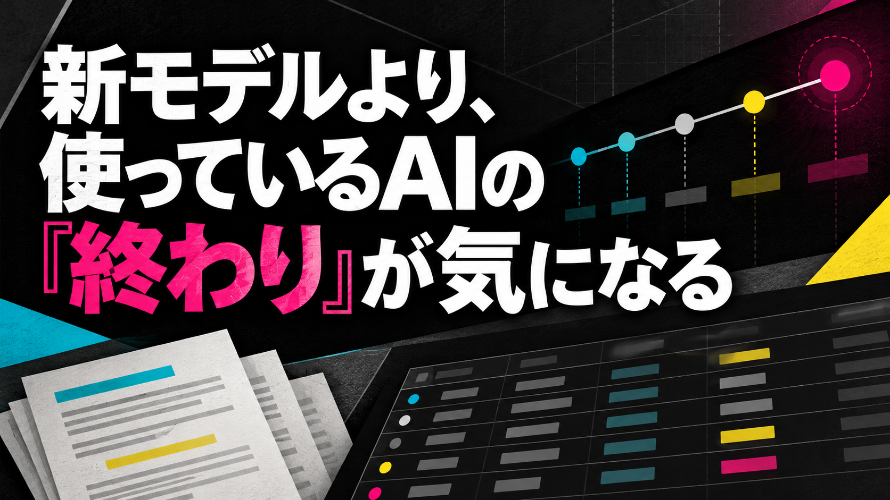
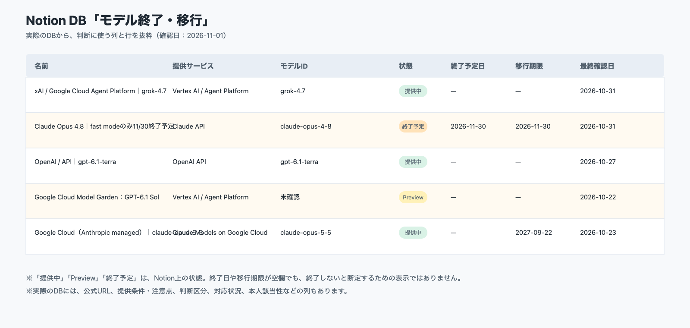

# 新モデルより、使っているAIの「終わり」が気になる

こんにちは、ぐみです。

この記事は、AIを自分のサービスや業務システムに組み込んでいる人に向けて書いています。新しいモデルを紹介する話ではなく、いま使っているモデルの終了や移行条件を追いかけ、判断に使えるよう情報を整理する話です。

新しいAIモデルが発表されると、性能や料金の話が気になります。

でも、私はAIをプロダクトに組み込んでいる立場です。最近もっと気になるのは、新しいモデルそのものより、いま使っているAIがいつまで使えるのか、ということです。

チャットで試すだけなら、別のモデルを選べば済むかもしれません。けれど、プロダクトの中で使っている場合は、モデルの提供が終わると、移行の準備が必要になります。料金が変わるだけでも、使い続けられるかを考え直すことになります。

そこで、DotというAIアシスタントに、複数のAI提供元が出している公式情報を定期的に確認してもらうことにしました。

最初は、Dotから確認結果をチャットで受け取っていました。そのあと「情報を溜めたい」と相談して、Notionにニュース用データベース（ニュースDB）、イベント一覧、モデル一覧を作りました。保存と更新まで進めてもらう形です。

集めているのは、AIの提供元が公開している公式サイトやブログ、ドキュメントの情報です。顧客の資料や業務の会話を使った事例ではありません。出典と確認日を残して、あとで元の情報へ戻れるようにしています。

## 性能の前に、「終わり」を確認したくなった

新しいAIモデルが発表されると、性能や料金の話が気になります。性能が上がった、料金が変わった、使える機能が増えた。そういうニュースは、つい見てしまいます。

でも、私はAIをプロダクトに組み込んでいる立場です。最近もっと気になるのは、新しいモデルそのものより、いま使っているAIがいつまで使えるのか、ということです。

チャットで試すだけなら、別のモデルを選べば済むかもしれません。けれど、プロダクトの中で使っている場合は、提供が終われば移行の準備が必要になります。料金が変わるだけでも、使い続けるかを考え直すことになります。

いま使っているモデルがどのサービスから提供されているのか。いつから使えるようになったのか。終了日や移行期限は決まっているのか。こうした情報も、性能や料金と同じように、モデルを選ぶ材料にしておきたいと思いました。

## Dotに、公式情報を定期的に確認してもらう

ここでいうAPIは、自分のサービスからAIを呼び出す仕組みです。今回集めるのは、そのAPIやモデルに関する、AI提供元の公式情報です。Dotには、公開されている公式サイトやブログ、ドキュメントを定期的に確認してもらいます。

- 新しいモデルの発表  
- 料金の変更  
- APIや運用に関する変更  
- モデルの提供開始  
- 提供終了や移行期限  
- 開発者向けイベントや大きなアップデート  

ここで大事なのは、ニュースをたくさん集めることではありません。あとから自分で判断できるように、何が変わったのかを残すことです。

ニュースとモデル情報を同じ場所に入れておけばいいと思っていました。けれど、モデルの発表や提供終了をニュースとして保存すると、あとでモデルの状態を確認したいときに探しにくい。

そこで、情報の種類を分けることにしました。

## ニュースとモデル一覧は、分けたほうが見やすい

ニュースとして残すのは、料金変更やAPIの仕様変更、運用上の大きな変化です。その時点で何が起きたのかを、出典と確認日と一緒に記録します。

一方、モデル一覧では、提供サービスとモデルID（サービス側でモデルを識別する名前）やバージョンを単位にして、開始・終了・移行期限を管理します。

この分け方にすると、「最近どんな変化があったか」と「いま使っているモデルはいつまで使えるか」を別々に見られます。

さらに、似ているようで違う日付も分けておきます。

- まだ公式に発表されていないものは、未確認  
- 最低限の提供が保証される日と、提供終了日は別  
- 予定日が来ただけで、終了済みとは判断しない  

予定されている日付が来たからといって、実際に終了したと決めつけるわけではありません。公式情報をもう一度確認してから状態を更新します。

こういう細かい区別は、ニュース記事を読むだけでは抜けやすいところです。あとで判断するための一覧を作るなら、最初から状態の意味を決めておいたほうがよさそうです。

実際のNotion DBは、モデルごとに1行で管理しています。下の画像は、モデル名、提供サービス、モデルID、状態、終了予定日、移行期限、最終確認日が見えるようにした実データの抜粋です。

## 「情報を溜めたい」から、一覧の形を変えた

今回よかったのは、AIに情報を集めてもらったことだけではありません。

使っているうちに、「モデルの発表と廃止は、ニュースDBに入れないほうがいいのでは」「提供サービスは選択式にしたほうが、あとで揺れにくい」と考えるようになりました。

最初から完璧なデータベースを設計したわけではありません。情報を見ながら、あとで自分が判断しやすい形へ少しずつ変えていきました。

AIは、情報を集めて整理するところを手伝ってくれます。けれど、何を同じ種類として扱うか、どの項目を残すかは、自分の使い方に合わせて決める必要があります。

ここを任せきりにすると、情報は増えても、判断しにくい一覧になってしまいます。

## 通知は、変わったものだけでいい

定期確認の結果を毎回すべて通知すると、今度は通知を見ることが仕事になります。

そこで、通常の通知は新しい差分だけにしています。新しい発表や状態の変化がなければ、無理にニュースを増やしません。

ただし、保存や更新をしたあとは、もう一度取得して確認します。書き込めたつもりの情報が本当に残っているか、状態が意図したものになっているかを見るためです。

この運用は、全件を自分で確認してから保存する形ではありません。Dotに情報収集からNotionへの保存、差分更新、更新後の再取得確認まで任せています。

ニュースとモデル情報の分け方や、残す項目を対話しながら調整しています。未確認とする状態も、同じように決めていきます。実際にモデルを選んだり移行を判断したりするときは、Notionの記録だけで決めず、公式出典を確認します。

収集・保存・更新を任せる範囲と、判断を自分が持つ範囲を分けることで、未確認の情報を確定扱いしにくくなります。

## 「終わり」まで見ておきたいのは、こんなとき

私が特に追っておきたいと思うのは、こんな場合です。

- AIを自分のサービスや業務システムに組み込んでいる  
- 複数の提供サービスやAPIを使い分けている  
- モデルの変更が、出力や料金に影響しそう  
- 新しい情報を集めているのに、あとから探し直している  
- 使っているモデルの終了日や移行条件を、すぐ答えられない  

AIをプロダクトに組み込んでいると、「何ができるか」と同じくらい「いつまで使えるか」も気になります。

新モデルを試すこと自体は、これからも続けると思います。ただ、そのたびに「これに乗り換えよう」と考えるだけではなく、いま使っているものの終わりも確認しておきたいと思っています。

## おわりに

Dotには公式情報の収集・保存・更新を任せています。NotionではニュースDBとモデル一覧を分け、出典と確認日も残します。

未確認の情報は未確認のまま置き、予定日だけで終了扱いにはしません。新モデルを試すことはこれからも続けますが、そのたびに、いま使っているものの終わりも一覧で確認しておきたいと思っています。
