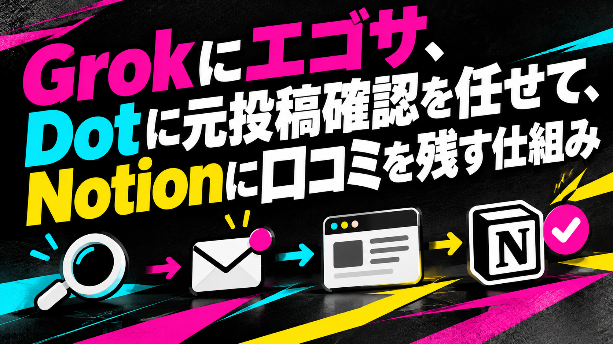
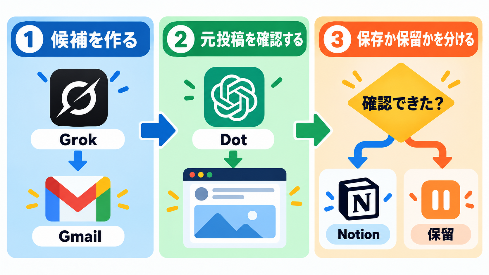

# Grokにエゴサ、Dotに元投稿確認を任せて、Notionに口コミを残す仕組み

こんばんは、ぐみです。

最初は、エゴサをどうすればうまくできるのか、よく分かりませんでした。そこで、Grokにエゴサを手伝ってもらうことにしました。

Grokにはスケジュール機能があり、定期的にエゴサできます。結果をメールでも受け取れると分かり、「これなら確認の流れをつなげられそう」と思いました。

もともと、AIに関するニュースはDotに集めて、Notionに蓄積していました。メールで届くなら、その内容をDotにも読ませられそうです。

しかもDotは、自分でブラウザへアクセスできます。Grokがまとめた日本語レポートと元投稿URLの一覧を読み、SNSの投稿を開いて、投稿画面のスクリーンショットも取得できます。

Grokで探して、Gmailで受け取る。Dotで元投稿を確認して、Notionへ保存する。そんな流れを考えました。

ただ、Grokに投稿を探してもらうだけでは、記録として少し不安が残ります。要約だけでは、元投稿の本文や投稿者、投稿日が分からないことがあるからです。そこで、検索結果をそのまま保存せず、元投稿まで確認する流れにしています。

これは完全自動の収集ではありません。Grokが候補を探し、Gmailを合図に、Dotが元投稿を確認してからNotionへ保存する仕組みです。

<!-- note:toc -->

## まず、通知を記録に変える全体フロー

いったん、こういう流れにしてみました。



1. Grokが毎時、複数の検索条件で対象サービスに関する日本語の投稿を探す

2. Grokが、好評・不評・体験談・不具合申告・改善要望などを日本語レポートにまとめ、候補となる元投稿URLも一覧化する

3. Gmailが、Grokから届いたレポートを受け取る

4. Dotが、指定した通知だけを起動契機として判定する

5. 通知内の「続きを読む」などから、ログイン済みのDotでGrokの会話を開く

6. DotがレポートのURL一覧を読み、ブラウザで元のSNS投稿を開いて、本文・投稿者・投稿日・直接URLを確認し、投稿画面のスクリーンショットを取得する

7. 元投稿を既存のNotionへ1投稿1件で保存し、保存後に再取得して検証する

流れだけを見ると自動収集に見えます。でも、中心にあるのは「Grokの要約をそのまま記録しない」ことです。通知は入口にして、元投稿まで確認したものだけを保存します。

## Grok側では、検索条件とレポートの役割を分ける

### 毎時の検索は、複数クエリで行う

対象サービスに関する投稿は、ひとつの検索語だけでは拾い方が偏ります。そこで、複数の検索条件を使い、日本語の投稿を探します。

私が見たいのは、だいたいこの4つです。

- 実際に使った感想や評価

- 困ったことや不具合の申告

- 改善してほしい点や要望

- 良かった点や便利だった使い方

私が欲しかったのは、言及された回数ではありません。あとから元投稿を開いて、どんな体験が語られていたのか確認できる材料です。

Grokは、見つけた投稿を毎時レポートにまとめ、候補となる元投稿URLも一覧化します。ただし、このレポートとURL一覧は候補の一覧です。投稿本文を正確に保存したものでも、内容が事実だと確定したものでもありません。

### レポートの分類は、判断の入口にとどめる

レポートには、好評・不評・体験談・不具合申告・改善要望などの分類を持たせます。分類があると、後で確認する順番を決めやすくなります。

「不具合申告」と分類されていても、私はいったん「そう感じた人がいた」という記録として見ています。実際に不具合なのか、今の仕様なのかまでは、投稿だけでは判断できません。

同じ理由で、好評の投稿をサービス全体の評価へ広げたり、一つの不満を一般的な問題として扱ったりもしません。レポートは「何を確認するか」を決めるために使います。

## Gmailの通知は、処理を始める合図として使う

Gmailで、Grokから届く通知を受け取ります。受信したメールをすべて処理対象にする必要はありません。

Dotには、届いたメールを全部渡しません。指定した自動処理IDに対応する通知だけを見ます。件名や送信元だけで判定すると、似た通知や別の自動処理まで混ざる可能性があるためです。実際に使う件名、送信元、識別子の条件は、利用環境に合わせて要確認です。

GmailはNotionそのものではありません。あくまで「新しい確認候補が来た」と知らせる起動契機です。メール本文だけを根拠に保存しないことで、Grokが作った要約と、元投稿の内容を分けて扱えます。

## Dotは、要約の確認係にする

ここが、この仕組みでいちばん大事にしているところです。

### ログイン済みの会話を開く

Dotは、通知の続きを読む先からGrokの会話を開きます。ログインが必要な画面なので、事前にログイン済みのDotを用意します。

ログイン状態の保持方法、セッションの有効期限、二段階認証が必要になった場合の扱いは、使う環境ごとに要確認です。ログイン情報や認証コードは、記事の設定例に書かないようにします。

### 元投稿まで戻って確認する

会話を開いても、Grokのレポートに書かれた要約やURL一覧だけでは判断しません。URL一覧を読み、ブラウザで元のSNS投稿を開きます。そこで、本文・投稿者・投稿日を確認し、必要に応じて投稿画面のスクリーンショットも取得します。

最低限、次の情報を見ます。

- 元投稿の本文

- 投稿者

- 投稿日

- 元投稿へ直接移動できるURL

スクリーンショットを取得する場合は、投稿者のアイコン、表示名、返信相手、通知、個人情報などが写り込まないかを確認します。Notionに保存する確認用画像と、noteなどで公開する画像は分け、公開用には必要な範囲を加工します。どこまで隠すか、保存先をどう管理するかは要確認です。

元投稿や画像を確認できない候補は、無理に保存しません。保留にして、元投稿まで確認できたものだけを記録対象にします。

## 既存のNotionには、1投稿1件で保存する

元投稿まで見られたものは、既存のNotionへ1投稿1件で保存します。新しいデータベースを作るのではなく、すでに使っているNotionへ追加する形です。

保存するNotionのプロパティ名や型は環境ごとに異なるため、ここは要確認です。本文、出典、投稿者、投稿日、直接URL、確認状態、画像の有無などを、あとから見直せる形で持たせます。

保存前には、全履歴を検索します。重複確認に使うキーは一つに限定せず、次の三つを照合します。

- 投稿ID

- 元投稿の直接URL

- 投稿本文

投稿IDやURLが取得できない場合もあるため、本文の一致も確認します。ただし、本文が同じでも別投稿という場合はあり得ます。投稿日や投稿者など、ほかの情報と合わせて判断します。

保存操作が成功したように見えても、それだけでは終わりにしません。Notionの保存ページを再取得し、本文、出典、プロパティ、画像が意図どおり残っているかを確認します。

再取得までできて、はじめて「記録できた」と扱います。

## 実際に使っている指示を匿名化した例

ここまでの流れを、実際のスケジュール指示に落とし込んだ例です。コード内の「対象IP名」「対象サービス名」「キャラクター名」などは、自分の環境の名前に置き換えて使います。記事では、IP名・キャラクター名・個人用URL・内部IDを匿名化しています。

### Grokのスケジュール指示

```text
対象IP／対象サービスのエゴサーチを実行し、日本語でレポートしてください。毎時実行なので、直近1〜3時間の新着を中心に収集してください。

## 検索戦略（複数クエリを実行して結果を統合）
以下のクエリを別々に検索し、必要に応じて意味検索も併用してください。日本語投稿を優先します。

1. #対象IP名 OR #対象サービス名 OR "対象サービス名" (アプリ OR チャット OR 体験)
2. #(対象IPの略称) (対象サービス名 OR アプリ OR チャット)
3. (対象IP名 OR 対象IPの別名) (対象サービス名 OR 対象サービスの別表記 OR アプリ)
4. (キャラクター名1 OR キャラクター名2 OR キャラクター名3) (対象サービス名 OR アプリ OR チャット)
5. 意味検索: "対象サービス名 アプリ 感想 OR 体験 OR 不具合 OR レビュー"

## 収集・除外ルール
- 一般ユーザー（非公式）の新着投稿を優先
- 公式アカウント、認証メール、販促、重複、純粋なリポスト、無関係な投稿は除外
- 対象IPと無関係な一般語や、別ジャンルの投稿は除外
- 声優個人の宣伝的な投稿は参考程度にし、ファンの口コミ・体験談を優先
- 件数が少ない場合でも、直近の関連投稿を拾える範囲で収集

## レポート形式（日本語）
1. 概要（今回の収集件数目安・主な趣旨・活発度）
2. 重要口コミ（好評・不評・体験談。キャラクター名や機能が分かるように）
3. 不具合・バグ報告
4. 改善要望
5. 全関連投稿リスト（収集できた関連投稿をURL付きで列挙し、各投稿に短い内容要約を付ける）
6. その他注目点

公式情報は参考程度に留め、ファンの生の声を優先してください。件数が少ない時間帯でも、拾えたものを誠実にまとめてください。
見つけた投稿は、後で元投稿を確認できるよう、直接移動できるURLを一覧にしてください。
```

### Dotのスケジュール指示

```text
Grok通知を契機に、対象IP／対象サービスの口コミ・体験談を既存Notionへ整理する。イベントは起動契機にすぎず、個人Gmailの実メール本文とFromを取得する。

対象にするのは、Grok通知のうち、指定した自動処理IDを指す「対象サービスのエゴサーチ 毎時」だけ。別のGrok通知、認証メール、販促メールは除外する。件名は変わるため、件名だけで限定しない。

メールの「続きを読む」先のGrok会話を、本人がログイン済みのDotのクラウドブラウザーで読み、元SNS投稿の直接リンクを取得する。Grokの要約は手がかりに留め、元投稿の本文・投稿者・日付を確認して、実際の投稿画面のスクリーンショットを撮る。新規質問の送信、Grokの設定変更、スケジュール変更はしない。

Grokのレポートにある好評・不評・体験談・不具合申告・改善要望を確認対象にする。ただし、申告を確定不具合や現行仕様と断定しない。公式ニュースや動画更新は別の記録に任せ、重複登録しない。

保存先は既存Notion内の「口コミ・体験談」。保存前に現行スキーマ、全項目、本文を取得し、投稿ID・URL・内容で重複確認する。1投稿1件で保存し、同じ投稿の再掲は除外する。意味のある訂正は、既存項目へ出典と履歴を保持して差分更新する。

本文には、短い要約、感想と事実・推測の区別、関連キャラクター、取得元Grokリンク、確認日時、確認限界を残す。投稿日表示の元タイムゾーンが不明な場合は注記し、推測しない。画像はその投稿の実画面を添付し、ギャラリーで確認できるようにする。

元投稿や画像を確認できない候補は、未確認として保留する。Grokの要約だけで確定登録しない。保存後は本文、出典、設定プロパティ、画像を再取得して検証する。

新規追加や重要訂正があった場合だけ、決めた時間帯に日本語で件数・要点・Notionリンクを短く通知する。変化がなければ通知しない。保存失敗や取得失敗を保存済み・新情報なしと解釈しない。

調査・指定DBへの保存・本人への通知だけを行う。メール変更、返信、投稿への反応、第三者連絡、購読、購入、共有権限変更、Grok設定変更は禁止する。認証情報を記録や通知へ保存しない。
```

## 自分の環境で試すときの順番

実際に置き換えるときは、次の順番で確認します。画面項目やデータベースのプロパティ名は環境によって変わるので、手元の設定に合わせてください。

1. **Grokの検索・スケジュール**：検索条件、日本語の対象、毎時実行が想定どおりかを確認します。

2. **Gmailの通知**：Grokのレポートが届くこと、送信元や自動処理IDで対象を絞れることを確認します。

3. **Dotのブラウザー**：ログイン状態を確認し、メールからGrokの会話を開けるかを試します。

4. **元投稿の確認**：URL一覧から投稿を開き、本文・投稿者・投稿日・直接URLを確認します。スクリーンショットに個人情報が写り込まないかも見ます。

5. **Notionへの保存**：既存スキーマ、投稿ID・直接URL・本文による重複確認、保存後の再取得を確認します。

個人用URLや内部ID、認証情報は記事へそのまま書かず、自分の環境だけで確認します。

## 使っていて、ここは分けて考えるようになった

最初は、見つかった投稿をできるだけ多く残せばいいと思っていました。でも、元投稿を確認していくと、公式のお知らせと利用者の感想は、同じ口コミとして扱わないほうが見返しやすいと分かりました。すでに保存した投稿や、元投稿まで確認できない候補も、無理にNotionへ入れずに保留します。

個人の投稿に書かれた不具合申告は、その人の体験として記録します。「確定した不具合」「現行仕様」「全員に起きる問題」とは書き換えません。改善要望も、要望が存在したことまでは残しますが、開発側が対応するかどうかは別の判断です。

通知も、毎時処理が動くたびには送らないようにしています。新しい投稿や重要な訂正があったときだけ、決めた時間帯に短く知らせます。変化がないときまで通知すると、あとで確認したい情報が埋もれてしまうからです。

毎時の検索を設定しても、すべての投稿を拾えるわけではありません。検索条件に入らない表現、公開範囲、Grok側の取得条件によって見つからない投稿があります。Gmailの遅延、ログイン状態の失効、Dotの停止、元投稿の削除などで、途中から確認できなくなることもあります。

だから、Notionには「元投稿確認済み」「重複で除外」「保留」「対象外」のような確認状態を持たせています。拾えなかったものがあることや、まだ確認できていないものがあることを、記録の中で分けておくためです。

## まとめ：Grok・Gmail・Dot・Notionで確認の流れをつくる

この仕組みは、Grokに見つけてもらい、Gmailを合図にDotで元投稿まで戻ります。確認できたものだけを、Notionへ重複なく保存します。

私の場合は、Grokの要約だけで保存せず、元投稿まで見られたものだけをNotionに残すようにしています。保存したあとも再取得して、ちゃんと記録が残っているかを見る。ここまで確認して、記録に残します。

自動化というと、たくさん集めて、すぐ通知することへ目が向きがちです。でも、観察対象の投稿を扱うなら、拾えなかったものがあることも前提にします。確認できないものは保存せず、変化がないときは静かにしておく。そこまで含めて、仕組みにしておきたいところです。

